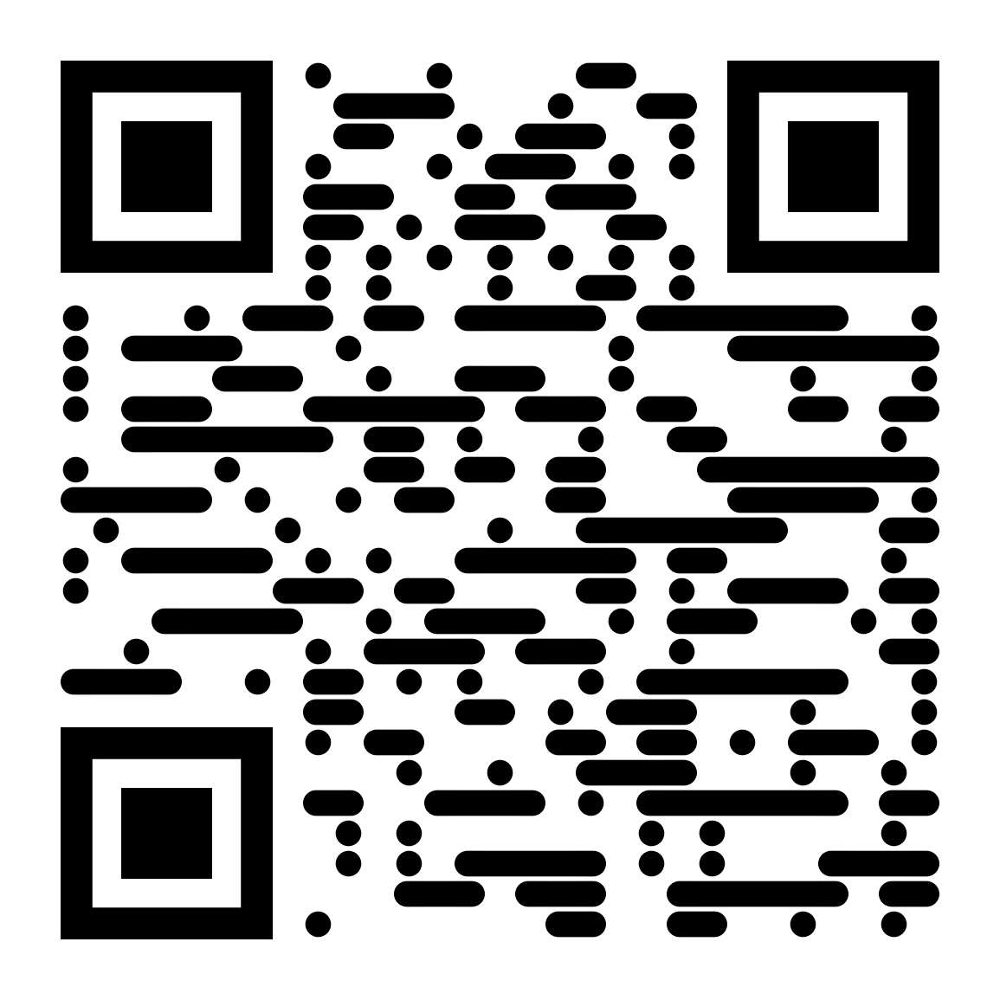

# ☕ Reboot Cafe - Digital Menu & Landing Page

!:

```markdown
# Reboot Cafe - Digital Menu & Landing Page ☕🌿

## 📌 Project Overview
A fully responsive, bilingual (Arabic & English) landing page and digital menu built for **Reboot Cafe** (A real-world coffee shop in Riyadh, Saudi Arabia). [HTML5](https://img.shields.io/badge/html5-%23E34F26.svg?style=for-the-badge&logo=html5&logoColor=white)

](https://rebootcafe.netlify.app)**

## ✨ Key1E)

A modern, responsive, and bilingual (Arabic/English) digital menu built as a proactive digital solution for a real-world local coffee Features
- **Bilingual Interface:** Seamless toggle between Arabic (RTL) and English (LTR) without reloading the page.
 shop in Riyadh, Saudi Arabia (Reboot Cafe).

## 🔗 Live Demo
**[View The Live Project Here](https://re- **Dynamic Menu Rendering:** Menu items are rendered dynamically using JavaScript arrays for easy future updates.
- **Responsive Design:** Mobilebootcafe.netlify.app)**  
*(You can also scan the QR code in this repository to test the mobile experience!-first approach ensuring a perfect UI on all devices (iOS & Android).
- **Custom SVG Logo:** Programmed the cafe)*

## 🎯 Project Purpose
Many local cafes still rely on printed menus, which incur recurring printing costs and lack's specific logo using SVG and FontAwesome icons instead of heavy images for faster loading times.
- **Direct Integr flexibility. I took the initiative to design and develop a fully functional digital alternative for Reboot Cafe to showcase how a tailored web solution can:ations:** Features direct links to Google Maps and a WhatsApp API shortcut for quick customer support.

## 🛠️ Built With
- **HTML5** (Semantic markup)
- **CSS3** (Custom properties, Flexbox,
* Eliminate printing costs.
* Enhance the user experience for both Arabic and English-speaking customers.
* Streamline operations through a quick QR- Grid, CSS transitions)
- **Vanilla JavaScript** (DOM manipulation)
- **FontAwesome** (Icons)
- **Google Fonts** (code scan.

## ✨ Features
- **Bilingual Interface:** Seamless instantaneous switching between Arabic (RTL) and English (LTR) using Vanilla JavaScript and CSS display toggling—no page reload required!
- **Dynamic Menu Rendering:** MenuCairo & Poppins)

## 📸 Preview
*Scan the QR Code below to view the mobile version!*
<br>


## 🚀 Use Case & Business Value
This project demonstrates my ability to:
1. Identify real-world business items are stored as an array of objects and injected dynamically into the DOM, making future updates (prices, new items) incredibly easy.
- **Custom UI/UX:** Designed a dark, coffee-themed UI matching the cafe's real-world branding, complete with a custom CSS-drawn logo (coffee beans) matching their physical storefront.
- **Fully Responsive:** Mobile needs.
2. Build fast, single-page applications (SPAs) optimized for user experience.
3. Deliver-first approach ensuring the menu looks perfect on any device.
- **Direct Integrations:** Embedded direct links to WhatsApp API a production-ready product for local businesses.
